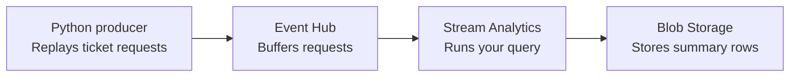

# Week 11 lab · The campus concert ticket rush

**CST8916 · Remote Data and Real-time Applications**

The student union has been selling early-access concert tickets. At **19:00 UTC**, sales open to the whole campus. A message arrives at the help desk. “I picked my seats, but checkout took forever.” Another student says their order went through. You’re the on-call analyst. **When did the trouble start, who experienced it, and what should the ticketing team investigate first?**

You’ll test queries against a short recording of the sale, then replay it through a live Azure pipeline. By the end you’ll have a JSON file of results and a two-sentence incident update backed by the data. Everything for this lab is in this folder.

| Stage                                                        | Time      | Finish line                                        |
| ------------------------------------------------------------ | --------- | -------------------------------------------------- |
| [1. Meet the incident](#1-meet-the-incident)                 | 10 min    | Read a request and make a prediction               |
| [2. Build the pipeline](#2-build-the-pipeline)               | 20–25 min | Connect the Event Hub input and Blob output        |
| [3. Investigate the recording](#3-investigate-the-recording) | 25–30 min | Find the slowdown and write a burst alert          |
| [4. Replay the sale live](#4-replay-the-sale-live)           | 15 min    | Verify a full run in Blob Storage                  |
| [5. Report and clean up](#5-report-and-clean-up)             | 5–10 min  | Brief the ticketing team and remove your resources |

## 1. Meet the incident

Download and extract this lab, or clone its repository. Open the folder containing `producer.py` and `requirements.txt` in your editor. You’ll also need **Python 3.11 or later**, a terminal, and access to the [Azure portal](https://portal.azure.com).

**Before you start Azure setup**

1. Sign in to the Azure portal with the account you used to activate **Azure for Students**. Open **Subscriptions** and confirm your student subscription is **Active**. Select it whenever a lab step asks for a subscription. [Activate Azure for Students](https://azure.microsoft.com/en-ca/free/students)
2. Check your remaining credit and expiry date on the **Balance** page of the Azure Sponsorships portal. Event Hubs, a running Stream Analytics job, and stored blobs can use that credit. Start the job only for the live replay and delete the lab resource group when you finish. If your subscription is disabled or your credit is exhausted, contact your instructor before creating resources. [Check your student credit](https://www.microsoftazuresponsorships.com/) · [Microsoft’s balance instructions](https://learn.microsoft.com/en-us/azure/cost-management-billing/manage/azurestudents-subscription-disabled#you-used-all-of-your-credit)



Open the [ticket-sale recording](sample/ticket-rush.json). Each object represents one completed HTTP request. A single visitor can make several requests. Here’s the first one, formatted for reading.

```json
{
  "eventTime": "2026-09-04T18:59:51.000Z",
  "requestId": "r01",
  "deviceType": "desktop",
  "path": "/tickets",
  "responseMs": 180,
  "statusCode": 200
}
```

| Field        | How to read it                                                                                     |
| ------------ | -------------------------------------------------------------------------------------------------- |
| `eventTime`  | When the request completed. The trailing `Z` means UTC.                                            |
| `requestId`  | Identifies one request in the recording.                                                           |
| `deviceType` | The visitor used a `phone` or a `desktop`.                                                         |
| `path`       | The page requested: `/tickets`, `/seats`, or `/checkout`.                                          |
| `responseMs` | Response time in milliseconds. The help desk considers **2,000 ms or more** slow.                  |
| `statusCode` | HTTP 200 means the request succeeded. HTTP 503 means the service was unavailable for that request. |

**Checkpoint.** Which two fields would tell you whether the complaint is specific to a device and page? Which field would distinguish a slow success from a failure? Write your prediction before opening the query editor.

### A first look at SAQL

**Azure Stream Analytics Query Language (SAQL)** is the SQL-based language you’ll use to ask questions about a stream of events. In this lab, an **event** is one completed ticket request, and a **stream** is the sequence of those requests. You describe the results you want. While the job runs, Azure keeps applying your query as requests arrive.

Think about what **one row of the result** should mean. For “Which requests were slow?”, each row should describe one request, so you need a filter on `responseMs`. For “How many requests came from phones every ten seconds?”, each row should summarize several requests. A **window** sets the span of time to include in that count.

A query is made of **clauses**, each with a job. You write `SELECT` first, but try reading the query starting at `FROM` to find the input. Then ask which requests to keep or group, what `SELECT` puts in one result row, and where `INTO` sends it. [SAQL reading guide](SAQL-Reference.md#read-a-query)

## 2. Build the pipeline

### Create the resources

1. In the Azure portal, open **Resource groups → Create**. Select **Azure for Students** and name the group `cst8916-week11-rg`. Choose a region your subscription allows that offers **Event Hubs**, **Stream Analytics**, and **Storage**. **Canada Central** is one option if it meets both conditions. Use the same subscription, group, and region for all three resources. [Azure product availability by region](https://azure.microsoft.com/en-ca/explore/global-infrastructure/products-by-region/table)
2. Search for **Event Hubs → Create**. Create a namespace named `tickets-<suffix>` on the **Basic** tier with **1 throughput unit**. A namespace holds event hubs. Replace `<suffix>` with a unique combination of letters and digits. After deployment, open the namespace, select **Event Hubs → + Event Hub**, and create `ticket-requests` with **1 partition** and **1 day** of retention. One partition keeps this small stream in send order.
3. In the namespace, open **Shared access policies → + Add**. Create `ticket-send` with **Send** as its only permission. Repeat for `ticket-listen` with **Listen** as its only permission. The Python producer uses the first policy, and the analytics job uses the second. Keep the primary connection string for `ticket-send` accessible in the portal for section 4.
4. Search for **Storage accounts → Create**. Choose a globally unique name such as `tickets26f<suffix>` using only lowercase letters and digits (3–24 characters total). Select **Standard**, **LRS** redundancy, and a general-purpose v2 account. For the connection-string setup, enable **Advanced → Allow storage account key access** on this new account. If your subscription blocks keys, use the managed identity option in [troubleshooting](#if-something-looks-wrong). After deployment, open **Data storage → Containers → + Container** and create a private container named `ticket-results`.
5. Search for **Stream Analytics jobs → Create**. Name the job `ticket-rush-<suffix>`, choose **Cloud**, and select **1/3 streaming unit** on Standard V2. Open the job after deployment. Leave it stopped while you work through the recording. [Streaming unit options](https://learn.microsoft.com/en-us/azure/stream-analytics/stream-analytics-streaming-unit-consumption)

### Connect the job

Inside the Stream Analytics job, add the following under **Job topology**. An **alias** is the name your query uses for a connection. Use the spellings below, including the hyphens.

|                | Event Hub input                                                    | Blob output                                                                                       |
| -------------- | ------------------------------------------------------------------ | ------------------------------------------------------------------------------------------------- |
| Add via        | **Inputs → Add input → Event Hub**                                 | **Outputs → Add output → Blob storage/ADLS Gen2**                                                 |
| Alias          | `ticket-requests`                                                  | `ticket-results`                                                                                  |
| Resource       | Your namespace → hub `ticket-requests` → consumer group `$Default` | Your storage account → container `ticket-results`                                                 |
| Authentication | **Connection string** → use existing policy `ticket-listen`        | **Connection string** (storage account key) → select the storage account you created in section 2 |
| Data format    | **JSON**, UTF-8                                                    | **JSON**, UTF-8, **Line separated**                                                               |

For the output, use **Append as results arrive**, path pattern `summaries/{date}/{time}`, date format `YYYY/MM/DD`, and time format `HH`. Set **Minimum rows** to **1** and **Maximum time** to **1 minute** if the batching fields appear. Save each connection. When using manual settings, the input takes the Listen policy name and its key. The storage output takes the storage account name and one of its access keys. Keep keys out of your code, screenshots, and incident update. [Blob output settings](https://learn.microsoft.com/en-us/azure/stream-analytics/blob-storage-azure-data-lake-gen2-output)

**Checkpoint.** Select each connection and choose **Test connection**, or inspect the test notification after saving. Resolve authentication or connection errors before continuing. An empty input preview is expected at this point.

## 3. Investigate the recording

Open **Job topology → Query**. Select `ticket-requests`, then **Input preview → Upload sample input**. Choose the included `sample/ticket-rush.json` and select **OK**. You should see the six fields from section 1. Keep this sample selected for all four questions. For each query, replace the **entire** editor contents and select **Test query**. Test results appear in the portal. Starting the job in section 4 enables live output. [Portal sample testing guide](https://learn.microsoft.com/en-us/azure/stream-analytics/stream-analytics-test-query#upload-sample-data-from-a-local-file)

### Query 1. What does one request look like?

```sql
SELECT *
INTO [ticket-results]
FROM [ticket-requests]
```

**Read the query**

1. `FROM [ticket-requests]` reads one event for each completed request. The square brackets keep the hyphenated connection name together.
2. `SELECT *` keeps every field. With one input and no filtering or grouping, each request produces one result row with the same six fields.
3. `INTO [ticket-results]` names the output for the running job. For this sample test, read the rows in the portal’s test results.

**Check.** The full sample returns **35 requests**. Find `r01` and match its page and response time to the example in section 1.

### Query 2. Which requests were slow?

Start with the help desk’s threshold. Leave the device and page open so the results can tell you where the issue occurred.

```sql
SELECT eventTime, requestId, deviceType, path, responseMs, statusCode
INTO [ticket-results]
FROM [ticket-requests]
WHERE responseMs >= 2000
```

**Read the query**

1. `WHERE responseMs >= 2000` tests each request. Read `>=` as “greater than or equal to.” A request taking exactly 2,000 ms qualifies. Request `r01`, at 180 ms, drops out here.
2. For each request that passes, `SELECT` lists the fields to show. Read `deviceType` and `path` to locate the slowdown, then `statusCode` to see whether that slow request succeeded. Each row still describes one request.

**Check.** Identify the earliest slow request, its device and page, and how many of the slow requests still succeeded.

<details>
<summary>Compare your evidence</summary>

Six rows qualify. All six are phone requests to `/checkout`. The first, `r13` at **19:00:02 UTC**, took exactly 2,000 ms and succeeded. One other slow request succeeded. The remaining four returned 503. Using `>` would have missed the first sign of trouble.

</details>

### Query 3. How did traffic change during the rush?

Compare phones and desktops over the same ten seconds. To measure both traffic and failures, start with all requests, including the fast ones.

```sql
SELECT System.Timestamp() AS windowEnd,
       deviceType,
       COUNT(*) AS requests,
       SUM(CASE WHEN statusCode >= 500 THEN 1 ELSE 0 END) AS failures
INTO [ticket-results]
FROM [ticket-requests] TIMESTAMP BY eventTime
GROUP BY deviceType, TumblingWindow(second, 10)
```

**Read the query**

1. `TIMESTAMP BY eventTime` uses the completion time inside each request to place it on the recording’s clock.
2. `GROUP BY deviceType, TumblingWindow(second, 10)` collects requests by device type and by fixed ten-second interval. Each request belongs to exactly one group. A phone request at 19:00:03 goes into the phone group ending at 19:00:10 UTC.
3. `COUNT(*) AS requests` counts every request in that group. The `CASE` gives each request a 1 if its status is 500 or higher and a 0 otherwise. `SUM(...) AS failures` adds those values. For example, `r13` (HTTP 200) and `r15` (HTTP 503) each add one to the phone request count, but only `r15` adds one to failures.
4. `AS` names a result column. `System.Timestamp() AS windowEnd` labels the row with the end of its interval. Read the desktop row ending at 19:00:00 UTC as “During those ten seconds, desktops made five requests and all five succeeded.”

**Keep this query handy.** It produces the live report in section 4.

**Check.** Find the phone and desktop rows for the busiest interval. Did both device types experience failures?

<details>
<summary>Check your six summary rows</summary>

Each cell shows **requests / failures**. The portal may display the rows in a different order.

| Window end (UTC) | Phone  | Desktop |
| ---------------- | ------ | ------- |
| 19:00:00         | 5 / 0  | 5 / 0   |
| 19:00:10         | 10 / 4 | 5 / 0   |
| 19:00:20         | 5 / 0  | 5 / 0   |

The middle interval contains 15 requests. Four of the ten phone requests failed. The five desktop requests in that same interval succeeded.

</details>

### Query 4. When should the on-call analyst get an alert?

Write an alert for **at least three failed checkouts on the same device type within any 10 seconds**. Lines beginning with `--` are comments. Replace both comments with clauses before testing.

```sql
SELECT System.Timestamp() AS alertTime, deviceType, COUNT(*) AS failedCheckouts
INTO [ticket-results]
FROM [ticket-requests] TIMESTAMP BY eventTime
-- Filter individual requests here.
GROUP BY deviceType, SlidingWindow(second, 10)
-- Keep only groups that meet the alert threshold here.
```

**Read the starter**

1. The first blank tests one request at a time. Which two fields tell you it was both a checkout and a server error?
2. `SlidingWindow(second, 10)` looks back ten seconds on the `eventTime` clock. For each device type, the count changes when a matching request enters that span or ages out of it.
3. The second blank tests the group’s count. For a group that passes, `SELECT` reports when the window ended (`alertTime`), the device type, and how many failed checkouts were in it (`failedCheckouts`).

<details>
<summary>Hint</summary>

Use `WHERE` to keep requests with `path = '/checkout'` and `statusCode >= 500`. After `GROUP BY`, use `HAVING` to test the count.

</details>

<details>
<summary>Worked query and alert times</summary>

```sql
SELECT System.Timestamp() AS alertTime, deviceType, COUNT(*) AS failedCheckouts
INTO [ticket-results]
FROM [ticket-requests] TIMESTAMP BY eventTime
WHERE path = '/checkout' AND statusCode >= 500
GROUP BY deviceType, SlidingWindow(second, 10)
HAVING COUNT(*) >= 3
```

`WHERE` keeps a request only when both conditions joined by `AND` are true. That makes `COUNT(*)` a count of failed checkouts for one device type. `HAVING COUNT(*) >= 3` keeps a result row whenever that count is three or more.

At **19:00:07 UTC**, `r21` joins `r15` and `r18` in the phone window, producing the first alert. The count reaches four at **19:00:09**. At **19:00:13**, `r15` ages out and three remain. That last row still meets the threshold even though the change came from an earlier failure leaving the window.

</details>

**Checkpoint.** Explain why Query 3 counts each request once and Query 4 can report the same failure in several alerts. For an optional exercise comparing overlapping reports, open the [SAQL reference and hopping-window challenge](SAQL-Reference.md#overlapping-reports).

## 4. Replay the sale live

### Prepare your terminal

Open a terminal **in the lab folder**. Create a virtual environment, activate it, and install the Event Hubs SDK.

**macOS / Linux**

```bash
python3 -m venv .venv
source .venv/bin/activate
python -m pip install -r requirements.txt
export EVENT_HUB_NAME='ticket-requests'
```

**Windows PowerShell**

```powershell
py -3 -m venv .venv
.\.venv\Scripts\Activate.ps1
python -m pip install -r requirements.txt
$env:EVENT_HUB_NAME = 'ticket-requests'
```

If PowerShell blocks the activation script, you can use the environment’s Python directly. Run `.\.venv\Scripts\python.exe -m pip install -r requirements.txt` now and `.\.venv\Scripts\python.exe producer.py` when you reach the replay step.

Open the Event Hubs namespace’s **Shared access policies → ticket-send** and copy **Connection string–primary key**. In the same terminal, run the command for your shell below. At the hidden prompt, paste the entire connection string and press **Enter**. The producer reads it from this terminal’s environment.

**macOS / Linux** (Bash or Zsh)

```bash
echo 'Paste the ticket-send connection string and press Enter:'
export EVENT_HUB_CONNECTION_STR
read -rs EVENT_HUB_CONNECTION_STR
```

**Windows PowerShell**

```powershell
$env:EVENT_HUB_CONNECTION_STR = [System.Net.NetworkCredential]::new('', (Read-Host 'Paste the ticket-send connection string' -AsSecureString)).Password
```

### Start the job, then send the requests

1. Go back to **Query**. Paste the complete tumbling-window query, including `INTO [ticket-results]`, and select **Save query**. The job’s configured Event Hub is its live input. [Return to Query 3](#query-3-how-did-traffic-change-during-the-rush)
2. In **Overview → Start**, choose output start time **Now**. Wait until the status shows **Running**.
3. In your prepared terminal, run the producer once:

   ```bash
   python producer.py
   ```

   It sends the 35 requests in their original order, about 28 seconds from first to last. It shifts the recording to the current UTC time so a job started today can process it. Note the first and last timestamps printed and look for **Replay complete**.

4. In the storage account, open **Containers → ticket-results → summaries**. Follow the **UTC** date and hour of your replay. Refresh after the windows close and allow a few minutes for Blob output. Download or preview the blob. Each line is one JSON summary. A replay near an hour boundary can use two folders.
5. Across the summary rows for one complete replay, add the `requests` values, then the `failures` values. Include both devices and all windows for the run. The exact window boundaries depend on when you started.

**Checkpoint.** Your live totals should be **35 requests and four failures**, all four in phone rows. A phone row with zero failures is consistent with the incident. The fixed sample’s six-row layout is specific to its original timestamps.

## 5. Report and clean up

Write two sentences for the student union using the **recording’s UTC clock**. In the first sentence, identify the earliest sign of trouble and one count that shows its impact. In the second, name the first page and device you would investigate and one comparison that supports your choice.

<details>
<summary>Compare with one possible incident update</summary>

At 19:00:02 UTC the first slow phone checkout completed, and four of the six slow phone checkouts returned HTTP 503 during the rush. I would check the logs for the phone checkout path first because desktop checkouts succeeded during the same interval and phone checkouts succeeded again in recovery.

</details>

1. Stop the Stream Analytics job from **Overview → Stop**.
2. Save any results you need. In your **Azure for Students** subscription, open **Resource groups → cst8916-week11-rg** and verify the group contains only your Week 11 resources.
3. Select **Delete resource group** and confirm the group name. Wait for the deletion to complete. This removes the Event Hubs namespace and storage account that can continue using student credit after the job stops. Close the terminal to clear its session credentials.

### If something looks wrong

| Symptom                                                                 | What to check                                                                                                                                                                                                                                                                                                                                                                                                                          |
| ----------------------------------------------------------------------- | -------------------------------------------------------------------------------------------------------------------------------------------------------------------------------------------------------------------------------------------------------------------------------------------------------------------------------------------------------------------------------------------------------------------------------------- |
| Azure rejects the region during creation                                | Open **Policy → Assignments**, set the scope to your **Azure for Students** subscription, and open **Allowed resource deployment regions** if listed. Under **Parameters**, find your allowed locations. Choose one that offers all three lab services and retry. [Student region policy guidance](https://learn.microsoft.com/en-us/answers/questions/5840169/unable-to-create-resource-on-azure-for-students-po)                     |
| The preview is empty, or Query 1 returns a different count              | Select `ticket-requests` in the query editor and upload the original sample file. **Reset** switches back to incoming hub data. Test Query 1 again.                                                                                                                                                                                                                                                                                    |
| The producer cannot connect                                             | Use the hub name `ticket-requests` and the **full** primary connection string from `ticket-send`. Set both variables in the terminal running Python. Check the SDK installed in the active virtual environment.                                                                                                                                                                                                                        |
| An input or output connection test fails                                | Check that both connections point to your Week 11 resources in **Azure for Students**. The Event Hub input uses `ticket-listen`. The Blob output uses the key from your lab storage account.                                                                                                                                                                                                                                           |
| Azure reports that Shared Key access is disabled on the storage account | Enable the Stream Analytics job’s **system-assigned managed identity**. In the storage account’s **Access control (IAM)**, assign that identity **Storage Blob Data Contributor**. In the job’s Blob output, choose **Managed identity (system-assigned)**, save, and retest after the role takes effect. [Microsoft’s Blob output walkthrough](https://learn.microsoft.com/en-us/azure/stream-analytics/blob-output-managed-identity) |
| The producer finished but the container looks empty                     | Verify the job was **Running** first, Query 3 was saved, and the UTC path matches your replay. In the job’s **Monitoring → Metrics**, inspect **Input Events**, **Output Events**, and **Runtime Errors**. Output batching can delay the blob.                                                                                                                                                                                         |
| Live totals include another replay or a partial run                     | Compare `windowEnd` with the terminal timestamps. For a clean measurement, wait at least 10 seconds after the previous send, then replay once and count only the new windows. A second complete replay contributes another 35 requests.                                                                                                                                                                                                |
